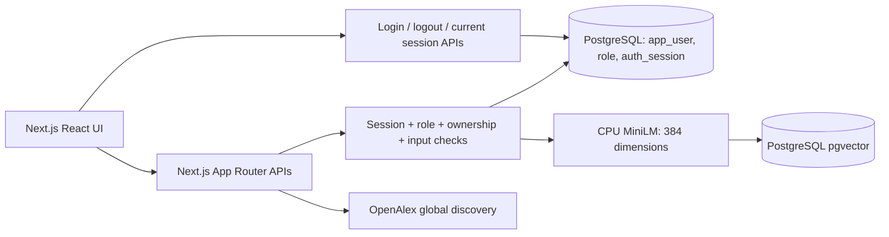
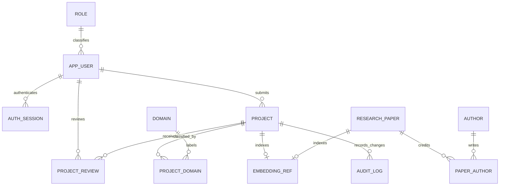

# ResearchX Level 3 implementation and report supplement

Project: **ResearchX — Intelligent Research Discovery & Project Similarity Platform**. PES University. Students: **Aayaan Kamil (PES2UG24CS017)** and **Abhinav Das (PES2UG24CS022)**. The existing print-ready report remains the source for university/guide details and its approved chapter order. This supplement updates the implemented system; earlier screenshots and October test outputs are historical evidence, not proof of the November changes.

The only supplied requirements source for this change was the user's eight-task brief. A separate faculty “DBMS Level 3 Project Requirements draft” was not present in the workspace/attachments. Exact compliance with wording outside the supplied brief is unverified.

## Problem statement, objectives and scope

Students need to discover research, compare proposals to existing local work, and receive faculty feedback without relying only on keyword matches. ResearchX combines normalized relational records, real semantic vectors and external literature discovery. Level 3 adds accountable access: a student must not submit as another person, edit somebody else's proposal, or approve their own work by forging a faculty ID.

Objectives: retain research discovery; implement real login/logout; enforce Student/Faculty/Admin permissions on the server; enforce data validity in PostgreSQL; preserve project/vector transaction consistency; demonstrate DDL, DML and at least four advanced database concepts with reproducible tests.

Scope: a locally demonstrated academic application. No registration service, OAuth, cloud deployment, payments or framework migration. Public users can browse projects/papers, discover OpenAlex works, and query semantic similarity. Logged-in members can save literature into a shared library. Administrative deletion applies to that shared library, not a fictional per-user bookmark collection.

## Functional requirements and permissions

| Operation | Public | Student | Faculty | Admin |
|---|---|---|---|---|
| Browse projects, papers, domains and statistics | Yes | Yes | Yes | Yes |
| OpenAlex discovery and local semantic search | Yes | Yes | Yes | Yes |
| Create a project | No | As self | No | As self |
| Edit/delete a project | No | Own projects | No | Any project |
| Review/approve/reject | No | No | As self | As self |
| Save an academic paper | No | Yes | Yes | Yes |
| Delete from the shared paper library | No | No | No | Yes |
| Account directory | No | No | No | Yes (never password hashes) |

Detailed global audit snapshots are Admin-only. A project audit history is available only to its Student owner, Faculty (who may review all projects), or Admin. Anonymous/other-Student browsing still returns the public project/reviews and aggregate statistics, with empty audit arrays. Both personalized GET responses use `Cache-Control: private, no-store` and `Vary: Cookie`; restricted UI history is cleared on session changes.

The server ignores client `student_id`, `faculty_id`, `role`, `status`, and `approved_by` when deciding identity/permissions. Only the explicitly supported fields are used. UI visibility improves usability; API checks enforce authorization independently. Project creation and editing keep embeddings in the same SQL transaction. Deletion uses one statement plus existing cascades/triggers, preventing the former two-statement vector/project deletion gap.

## Architecture and frontend/API integration



Existing pages remain. `/login` is added in the same Tailwind style. Navigation shows login/logout; project forms display the authenticated author instead of a persona selector. Review forms display the session reviewer. Unauthenticated create/edit screens offer login, and disallowed roles receive an explanation. Existing research discovery and similarity routes remain public.

## ER model, ER-to-relational mapping and schema



`PROJECT_DOMAIN(project_id, domain_id)` and `PAPER_AUTHOR(paper_id, author_id)` implement many-to-many relationships with composite primary keys. `app_user.role_id`, project ownership, reviews and author mappings use actual foreign keys. `embedding_ref` is polymorphic: its two conceptual parent relationships are enforced by parent-existence/key-share and parent-key triggers, not a single ordinary FK. Existing parent-deletion triggers cascade vectors. Audit records deliberately survive deletion; their project reference is logical, not a cascading FK. `auth_session(token_hash PK, user_id FK, created_at, expires_at)` adds one-to-many user sessions. `auth_login_attempt(username PK, attempts, window_start)` stores throttling state, including nonexistent names, so it intentionally has no user FK.

The original eleven relations and keys remain. Two security relations and two views are added. See [DATA_DICTIONARY.md](DATA_DICTIONARY.md) for all migrated columns and nullability, and `database/schema.sql` for original keys/constraints/indexes. **Do not run that destructive bootstrap file against existing data.**

## Database choice and justification

PostgreSQL supplies relational constraints, transactional stored procedures, concurrency control, joins, aggregates and triggers. pgvector keeps retrieval close to relational metadata, avoiding a separate vector service and distributed consistency problem. The repository documents PostgreSQL 16.4/pgvector 0.8.6 as its original reference versions; this environment actually verified PostgreSQL **16.15** and pgvector **0.8.7**, preserving the PostgreSQL 16 architecture.

## SQL implementation: DDL, DML, views and advanced queries

`database/migrations/001_level3.sql` is additive and idempotent. It executes inside one transaction. It adds session/rate-limit tables and indexes, `ALTER TABLE ... ADD CONSTRAINT ... NOT VALID` followed by validation, the embedding-parent/key guards, and these views:

- `v_project_overview`: project owner, domains, status, number of reviews and vector-index state, without duplicate projects caused by joins.
- `v_domain_statistics`: total/approved/pending counts per domain, including empty domains.

Compatibility checks reject invalid existing project records or orphan vectors with an explanatory migration error; they never delete or silently rewrite those records. Titles must contain non-whitespace text and be at most 255 characters. Problem statements have 10–10000 trimmed characters and non-whitespace text; descriptions are limited to 20000 characters. Existing status, review-decision, uniqueness and foreign-key constraints remain. Blank paper titles are rejected. Parent row key-share locks prevent vector insertion racing with deletion; indexed entity key changes cannot strand vectors.

`database/ddl_demonstration.sql` safely demonstrates CREATE TABLE, ALTER TABLE, DROP TABLE, primary/foreign keys, UNIQUE, NOT NULL, CHECK, index creation, CREATE/DROP VIEW, INSERT and SELECT. It uses only temporary demonstration tables/views inside a rolled-back transaction. Permanent views installed by the migration are then queried. Existing `database/queries.sql` demonstrates aggregation/HAVING, correlated and nested subqueries, joins and DML; it contains UPDATE/DELETE, so execute it inside a rollback transaction for repeatable evaluation on populated data. `database/vector_queries.sql` demonstrates cosine retrieval.

```sql
SELECT * FROM v_project_overview ORDER BY project_id;
SELECT * FROM v_domain_statistics ORDER BY approved_projects DESC;
-- Parameterized application similarity: 1 - (embedding <=> $1::vector)
-- Parameterized review: CALL sp_review_and_approve_project($1,$2,$3,$4)
```

## Advanced concepts and semantic metric

1. **ACID transactions**: project/vector inserts and updates commit together; failed domain/FK/constraint checks roll back. Tests check rollback and absence of partial records.
2. **Stored procedures/functions**: `sp_review_and_approve_project` validates Faculty/Admin role and atomically inserts the review and updates project status. API derives its reviewer argument from the session.
3. **Triggers**: timestamp and INSERT/UPDATE/DELETE audit triggers execute on real PostgreSQL rows. Deletion triggers remove vectors; new triggers reject missing parents and indexed key changes.
4. **Indexing**: original relational indexes and HNSW `vector_cosine_ops` index remain; session-user and expiry indexes are added.
5. **Vector similarity**: actual CPU `Xenova/all-MiniLM-L6-v2` produces mean-pooled, normalized 384-dimensional embeddings, stored as `vector(384)`. Ranking uses cosine similarity `1 - cosine_distance`, with source-project exclusion where requested. Current API combines grouped project/paper results and sorts computed scores; the existence of HNSW does not mean this UNION query necessarily uses an approximate index scan. `vector_queries.sql` provides nearest-neighbour demonstrations.

OpenAlex searches global literature. Semantic search ranks only locally stored indexed projects and papers. Scores express semantic alignment, **not plagiarism or duplication probabilities**. No mock vectors or invented papers are used as substitutes for integration verification.

## Authentication and credential security

For a fresh Windows checkout and exact PowerShell/NTFS instructions, see [WINDOWS_SETUP.md](WINDOWS_SETUP.md). Native Windows execution is not claimed in this Linux environment.

Passwords use Node's built-in scrypt (N=32768, r=8, p=1), independent random 16-byte salts, 64-byte derived keys and constant-time comparison. Demo initialization replaces only legacy dummy/uninitialized hashes, with randomly generated passwords written exclusively to a private file outside the checkout. POSIX requires an owner-only directory and mode-0600 file; Windows requires a verified private NTFS ACL, because POSIX modes do not protect Windows files. It preserves initialized accounts on rerun. There is no universal committed password. Demo usernames: `aayaan_s`, `priya_k` (Students), `dr_shilpa`, `prof_sandesh` (Faculty), `admin_researchx` (Admin). Seed files contain only locked `!uninitialized` markers until initialization.

Sessions use 256-bit random opaque tokens, only SHA256 token hashes stored in PostgreSQL, absolute eight-hour expiry, and database role lookup on every request. Login rotates the current cookie; logout deletes the server session and expires the cookie. Cookies are HTTP-only, SameSite=Lax, Path=/, and Secure by default. `SESSION_COOKIE_SECURE=false` is an explicit exception only for a local HTTP demonstration; use true for HTTPS. No signing secret is needed for opaque server sessions. Do not put session tokens in localStorage. Failed logins return one generic error and are throttled per username (10 attempts per 15-minute window) in PostgreSQL. This is a small local academic scheme, not a public-service account recovery or distributed abuse-prevention system.

Mutation APIs reject mismatching Origin and cross-site Fetch Metadata. SameSite cookies protect ordinary browser cross-site requests; non-browser tests may omit Origin. JSON shape/size, strings, IDs, domain lists and paper metadata/URLs are validated. SQL values are parameterized. Internal database errors stay server-side; responses contain generic or deliberate validation messages. Public project results omit account emails; password hashes/tokens are never returned by account APIs.

All application and utility database connections require `DATABASE_URL`. `.env.example` contains placeholders only. Local `.env.local`, backup files, generated passwords and session data must never be committed. SQL administrators can bypass application role checks by design; do not give demo users database superuser credentials. Filesystem/process memory and backup access remain local-machine trust boundaries.

## Safe local execution and backup

From the checkout, with Node 24 (verified here), PostgreSQL 16 + pgvector and existing data available:

```bash
npm ci
# Copy .env.example to .env.local; fill DATABASE_URL privately.
# Bash: export configured local variables for Node utility scripts.
set -a; . ./.env.local; set +a
# Before migration, write an encrypted/access-controlled backup OUTSIDE the checkout:
umask 077
pg_dump --format=custom --file="$BACKUP_FILE" "$DATABASE_URL"
pg_restore --list "$BACKUP_FILE" > "$BACKUP_MANIFEST_FILE"
node scripts/migrate.mjs
# Use a new, private absolute file path outside this checkout:
export DEMO_CREDENTIALS_FILE=/private/path/researchx-demo-credentials.json
node scripts/init_demo_accounts.mjs
# Read that file locally to obtain generated passwords. Do not paste it into chat/logs.
node scripts/generate_seed_embeddings.mjs
npm run build
npm run start
# Or npm run dev for development.
```

On this Cloud machine, PostgreSQL tools reside in the existing `researchx-postgres` container. The verified backup equivalent was `docker exec researchx-postgres pg_dump -U postgres -d researchx -Fc > /workspace/.researchx/level3-before.dump`, followed by `docker exec -i researchx-postgres pg_restore --list < /workspace/.researchx/level3-before.dump` (using the managed local Docker socket). Neither a restore nor schema reset was performed. Keep backup/manifest files private; hashes in backups are sensitive.

When using the session's outbound proxy, run Node clients with `NODE_USE_ENV_PROXY=1` and preserve CA trust/TLS verification. The configured model host redirects must remain allowed. Do not reinstall dependencies or regenerate vectors on every start. Published snapshots retain files/data, not running processes. Use the existing isolated checkout; no Git worktree is needed.

## Reproducible testing and evidence

```bash
export TEST_CREDENTIALS_FILE="$DEMO_CREDENTIALS_FILE"
node scripts/test_audit_access.mjs
# Opt in only with CREATE DATABASE permission; creates/drops its own disposable DB.
ALLOW_DISPOSABLE_DATABASE_TEST=true node scripts/test_account_initialization.mjs
node scripts/test_auth.mjs
node scripts/test_database_integrity.mjs
node scripts/test_platform.mjs
node scripts/test_phase3_corrections.mjs
node scripts/test_transaction_rollback.mjs
CHROME_PATH=/usr/bin/chromium node scripts/test_responsive_navigation.mjs
CHROME_PATH=/usr/bin/chromium node scripts/verify_targeted_ui_fix.mjs
CHROME_PATH=/usr/bin/chromium node scripts/verify_browser_and_screenshots.mjs
npm run build
npx tsc --noEmit
npm run lint
```

Use the installed Chrome path on Windows instead. Browser tests use real UI logins, never an authorization bypass. Existing platform and Phase 3 assertions are retained with Student/Faculty/Admin session clients replacing browser-supplied identity impersonation. The browser runner now has configurable paths, updated selectors for the already-existing empty search inputs, strict saving/vector verification and cleanup of its own added project/papers. Run mutation suites serially to avoid cleanup/baseline races. Tests require the provisioned demo usernames/IDs and seeded records; use a dedicated local demonstration database when running them elsewhere.

See [VERIFICATION.md](VERIFICATION.md) for actual pass/fail counts and screenshot links after execution. Claims outside recorded checks are unverified, not assumed. Historical report screenshots are retained without relabelling them as new executions.

## Individual contributions and evidence limits

| Student | Intended responsibility supplied by the team | Evidence status |
|---|---|---|
| Aayaan Kamil — PES2UG24CS017 | Relational architecture; ER/schema mapping; PostgreSQL/SQL; procedures/triggers; pgvector/backend integration; tests | Visible repository history contains commits under Aayaan Kamil/Aayaan721, spanning database and application work. Author labels alone do not prove the precise personal division of work. |
| Abhinav Das — PES2UG24CS022 | Next.js/UI/forms/dashboard/search; OpenAlex/API integration; database queries/relationships/DML; tests/documentation | Included in the existing report and supplied responsibility plan. No distinct Abhinav-authored commits were found in the available history; completion of each individual item is **unverified** pending the team's evidence. |

Both intended allocations include database and application development, as requested. This change was implemented with assistant assistance; do not attribute new commits or generated evidence to either student as independently completed work. No authorship, timestamps, evaluations or contributions have been fabricated. Students should add genuine contribution evidence before faculty submission.

## Conclusion and future enhancements

The implementation retains the existing relational/vector discovery architecture while adding accountable local authentication, server-side permissions and direct database validation. The new views and temporary DDL demonstrations make requirements executable rather than merely descriptive. Future work can include account/password administration, richer audit coverage and a per-user bookmark model; these are not claimed as implemented. A separate faculty draft, contribution confirmations and faculty acceptance remain outside verifiable evidence in this task.
